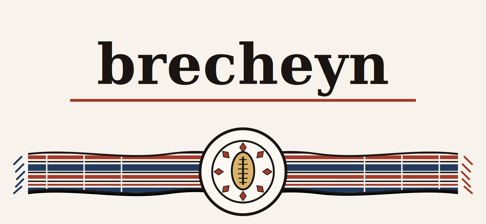

  

  

  
  
  
  

 

<table>
<tr>
<td width="48%" valign="top">
  
</td>
<td width="52%" valign="top">

### About

I grew up in Fada N'Gourma speaking Gourmantchéma and Mooré long before French. Switching between languages taught me early how to connect worlds that don't naturally understand each other — which is exactly what I do with software today.

I work across the whole chain: from microcontrollers to backends, from offline-first mobile apps to applied AI. I favour architectures that are **simple, robust and easy to maintain** — systems you can trust at 3 a.m.

</td>
</tr>
</table>

### Selected work

<table>
<tr>
<td width="50%"></td>
<td width="50%"></td>
</tr>
<tr>
<td width="50%"></td>
<td width="50%"></td>
</tr>
</table>

Also on the shelf → <a href="https://github.com/Brecheyn/Eventhub"><b>EventHub</b></a> (events, registrations &amp; certificates) · <a href="https://github.com/Brecheyn/Cybersecurity-Hands-On-Lab-Module-1-Understanding-Basic-Security-Weaknesses"><b>Cybersecurity Lab</b></a> · <a href="https://github.com/Brecheyn/portfolio"><b>Portfolio</b></a> (Angular) · <a href="https://github.com/Brecheyn/Cl_creator">CL_Creator source</a>

  

### Toolbox

<table>
<tr>
<td width="22%"><b>Languages</b> daily drivers</td>
<td></td>
</tr>
<tr>
<td><b>Mobile &amp; front-end</b> offline-first, design systems</td>
<td></td>
</tr>
<tr>
<td><b>Back-end</b> APIs &amp; services</td>
<td></td>
</tr>
<tr>
<td><b>Data</b> relational modelling, Merise / UML</td>
<td></td>
</tr>
<tr>
<td><b>IoT &amp; systems</b> ESP32, PlatformIO, containers</td>
<td></td>
</tr>
<tr>
<td><b>AI &amp; security</b> applied ML, network analysis</td>
<td></td>
</tr>
</table>

 

### Activity

  
  

  

  

 

  
  
  

